# Examples

The scripts in `examples/` (an environment of their own: ThetaL by path, DotPlots to draw in the terminal) run a
flow and draw it. Run one from the package root:

```
julia --project=examples examples/hele_shaw.jl
```

Each section has an animation of the run and, beside it, a check of it.

## Mean curvature flow

**`mean_curvature_flow.jl`**: a five-lobed star under ``U = -\kappa``, with `q -> -q^2` and Δt ∝ 1/max κ², run
to 95 % of its extinction time ``A_0/2\pi``. It turns convex, then round. This is `evolve` in one call.

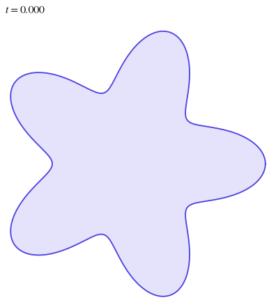
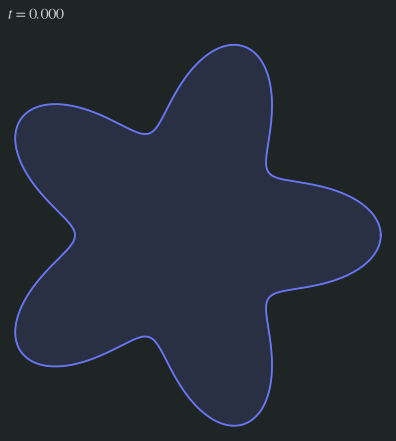
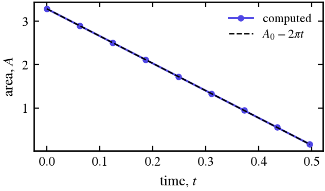
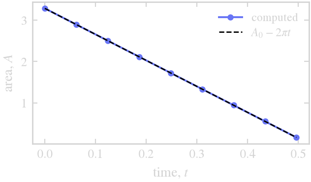

Curve shortening removes area at the rate ``2\pi`` (``\int\kappa\,ds = 2\pi``): the star's area against
``A_0 - 2\pi t``.

## Wind-up in a vortex

**`vortex_windup.jl`**: a disk off the center of a Lamb–Oseen vortex, wound into a spiral (each point turns at
``\omega(r)``). There is no symbol, because the motion is not stiff. The rigid part of the motion (the mean
rotation and the drift of the disk) is integrated exactly, and the shear explicitly. N doubles as the filament
lengthens and sharpens, from 64 points to 8192.

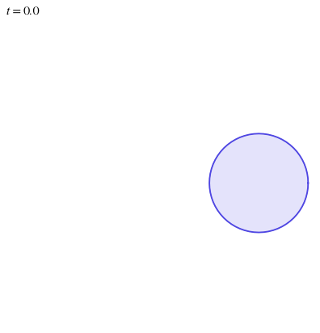
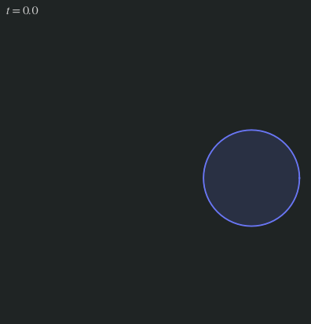
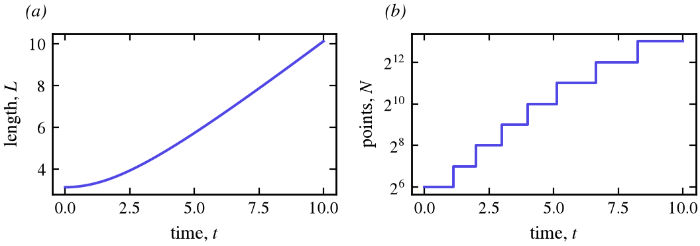
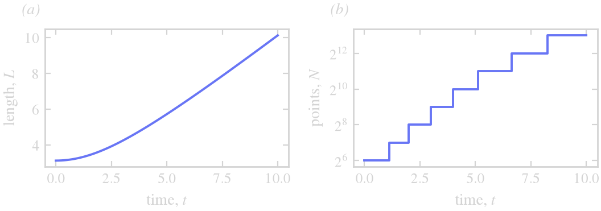

*(a)* The curve lengthens without bound as the shear winds it up. *(b)* N doubles whenever the spectral tail of
``\varphi`` exceeds `tol`, seven times in all.

## Hele-Shaw

**`hele_shaw.jl`**: air is injected at the rate ``J = 2\pi`` into a bubble in a Hele-Shaw cell. The viscous fluid
outside moves by Darcy's law ``u = -\nabla p``, with ``p`` harmonic outside the bubble,
``p \sim -(J/2\pi)\log r`` far away, ``p = -S\kappa`` on the interface (surface tension ``S = 0.005``), and
``U = -\partial p/\partial n``. ThetaL is not told any of this. The velocity solves the exterior Dirichlet problem
itself, with a Cauchy integral whose density comes from a dense ``N \times N`` solve, using the trapezoidal rule on
ThetaL's equal-arclength grid (spectrally accurate once the singularity is subtracted). On a circle of radius ``R``
a mode ``k`` grows at ``\sigma = (k-1)J/2\pi R^2 - S k(k^2-1)/R^3``. The small scales are damped at
``\sigma \approx -S q^3``, which is the `symbol` (HLS 1994 scale Darcy's law by ``1/2``, hence their
``-S q^3/2``). The bubble grows faster than surface tension can keep it round, so it splits into fingers whose
tips split again (Saffman–Taylor). Because the stiff part is integrated exactly, the step only has to follow the
grid spacing, ``\Delta t = \tfrac12 L/N``. N doubles from 256 to 1024 as the fingers sharpen, and the run takes a
few seconds.

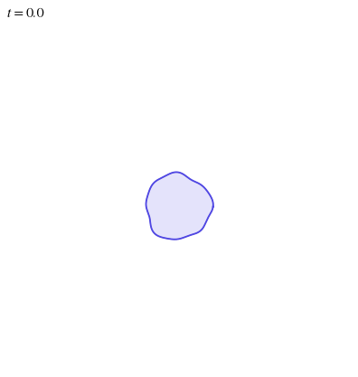
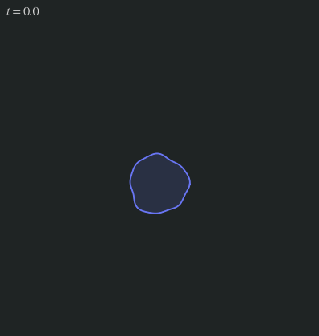
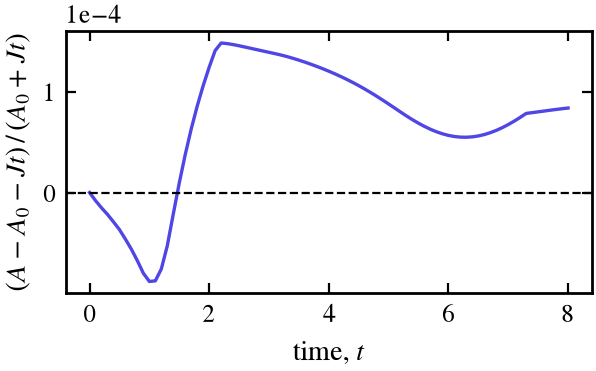
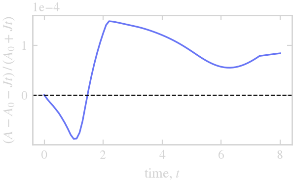

The bubble gains area at the injection rate ``J``, which nothing in the velocity imposes: the relative error in
``A = A_0 + Jt`` stays near ``10^{-4}``.

## Hele-Shaw with several bubbles

**`hele_shaw_bubbles.jl`**: three bubbles of different sizes in one cell, each injected at ``J = 2\pi``
(``S = 0.01``). They share the fluid around them. The fluid between two bubbles is pushed out by both, so its
pressure stays high, and the facing sides flatten into parallel walls and hold back while the fingers grow
outward into open fluid. The bubbles screen each other and never come closer than about 1.5.

- **One velocity for all the curves.** `U(Xs, t)` returns one vector per curve. A single dense solve couples every
  interface: the Cauchy integral runs over all of them, and each bubble adds one unknown, its pressure ``P_k``,
  with the condition that pins the constant the integral cannot see on that curve.
- **Where the source sits.** Each bubble's injection is a logarithm centered at any point inside it. The centroid
  will not do, because pushed by their neighbors the bubbles turn lopsided, and a fjord can grow onto the centroid.
  The source is the deepest of a few candidate points instead.
- **The step from the velocity.** The finger tips move at ``|U|`` up to about 3. The `callback` reads the largest
  ``|U|`` from `integ.U` after each step, and `dt` gives ``\Delta t = \tfrac14\,(L/N)/\max|U|``.
- **Close approach.** The same callback stops the run if two interfaces come within 0.05 (`min_distance`). Below
  that the coupling between them is stiff in a way no symbol expresses (see [Limits](@ref)), and the bubbles would
  soon merge, which ThetaL does not do.

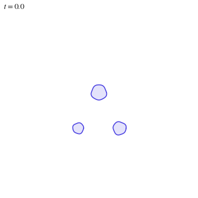
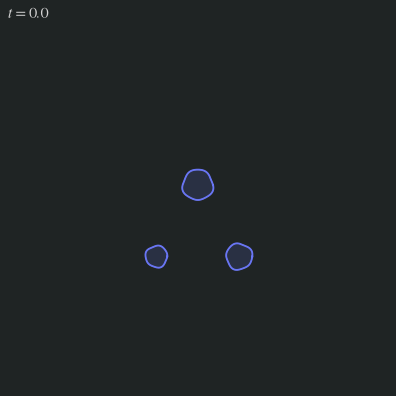
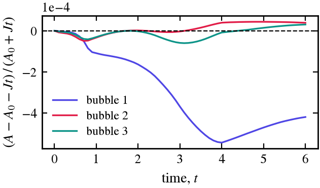
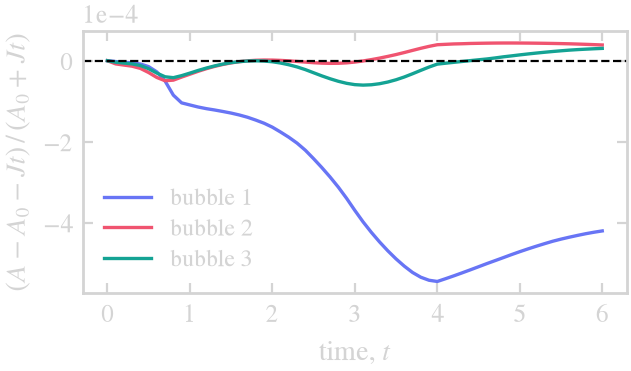

Each bubble gains area at its own rate ``J``, a check on the velocity and on the pressures ``P_k``: the relative
error stays below ``6 \times 10^{-4}``. Bubble 1, the largest, has the largest error, from time stepping (it falls
as ``\Delta t`` does).

## Vesicles

**`vesicles.jl`**: closed membranes that resist bending (Helfrich), with the area ``A`` they enclose and their
length ``L`` both fixed. Each relaxes by Willmore flow, the gradient flow of the bending energy
``E = \tfrac12\oint\kappa^2\,ds``, to the shape set by its reduced area ``\nu = 4\pi A/L^2``: ellipse-like near
``\nu = 1``, then biconcave, the two-dimensional red blood cell, with deeper dimples as ``\nu`` falls.

- **The velocity.** With ``\kappa_t = -U_{ss} - \kappa^2 U``, ``dE/dt = -\oint(\kappa_{ss} + \tfrac12\kappa^3)U\,ds``,
  so ``U = \kappa_{ss} + \tfrac12\kappa^3 + p - \sigma\kappa``, with a pressure ``p`` and a tension ``\sigma`` from a
  2 × 2 solve per curve at each evaluation. The stiff part is ``\kappa_{ss}``: `q -> -q^4`.
- **Holding A and L.** Setting ``dA/dt = \oint U\,ds`` and ``dL/dt = \oint\kappa U\,ds`` to zero still lets ``A``
  and ``L`` drift by the error of the step, most in the first steps (the initial layer of [Limits](@ref)). Setting
  them to ``(A_0 - A)/\tau`` and ``(L_0 - L)/\tau`` instead holds ``\nu`` to roundoff once the shapes settle.
- **The step.** ``\Delta t \propto 1/\max\kappa^4`` while the tips of the starting ellipses relax, then
  ``10^{-3}``. Larger first steps leave an error that breaks the symmetry of the start.

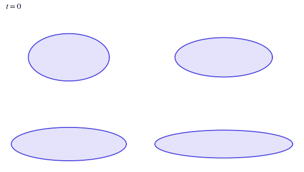
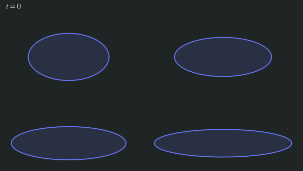
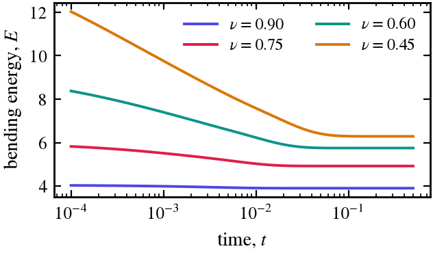
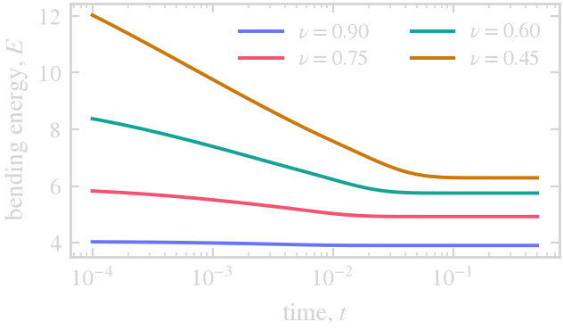

The bending energy falls monotonically to its equilibrium value, lower the rounder the vesicle. The frames of the
animation are spaced logarithmically in time, from ``10^{-4}`` to 0.5: almost all the change is over by ``t = 0.03``.

## More scripts

`examples/` also has `surface_diffusion.jl` (``U = \kappa_{ss}``, `q -> -q^4`), `step_control.jl` (the step from
the embedded error estimate, see [Limits](@ref)), `anisotropy.jl` (a symbol that depends on the curve, see
[Symbols, filter and resolution](@ref)), `rigid_rotation.jl` (a star turning about an outside point, its shape
kept exactly) and `coarsening.jl` (twelve particles under a mean field, driven with `init` and `advance!`,
removed as they vanish).
