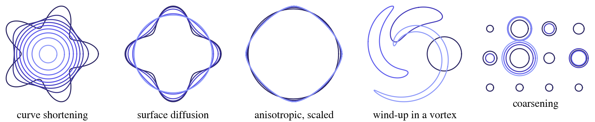
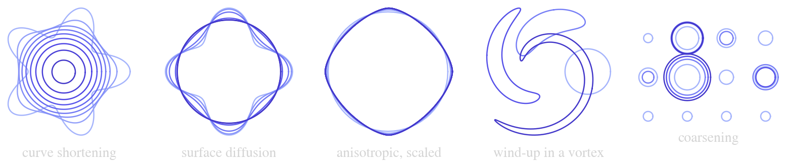
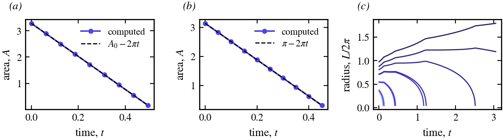
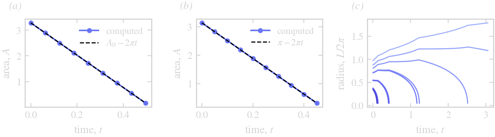

# Examples

The scripts in `examples/` (an environment of their own: ThetaL by path, DotPlots to draw in the terminal) run a
flow and draw it. Run one from the package root:

```
julia --project=examples examples/coarsening.jl
```




Curves at successive times, darker earlier: curve shortening of a star, surface diffusion of a flower, anisotropic
curve shortening (scaled to equal area: the circle turns into the four-fold Wulff shape), a disk wound into a
filament by a vortex, and twelve particles coarsening under a mean field.




*(a)* Curve shortening removes area at the rate ``2\pi``: the star's area against ``A_0 - 2\pi t``. *(b)* So does
anisotropic curve shortening, ``\int(\gamma + \gamma'')\,d\vartheta = 2\pi``: the area against ``\pi - 2\pi t``.
*(c)* The radii ``L/2\pi`` of the coarsening particles, coloured by their initial size: the small ones vanish and are
removed, the large ones grow, and each vanishing changes the mean field the rest feel.

## Geometric flows

**`mean_curvature_flow.jl`**: a five-lobed star under ``U = -\kappa`` with `q -> -q^2` and Δt ∝ 1/max κ², to
95 % of its extinction time ``A_0/2\pi``: it turns convex, then round.

**`surface_diffusion.jl`**: a four-lobed flower under ``U = \kappa_{ss}`` (`arclength_derivative` twice) with
`q -> -q^4`, relaxing to the circle of the same area; its lobes decay at the rate ``q^4 \approx 256``, so the
run is short (``t \le 0.02``).

**`step_control.jl`**: the same flower with the step chosen from ETDRK2's embedded estimate: small steps through
the initial layer, then large ones. It draws the accepted steps, then the curve. See [Limits](@ref).

**`anisotropy.jl`**: ``U = -(\gamma + \gamma'')(\vartheta)\kappa`` with ``\gamma = 1 + 0.05\cos 4\vartheta``, a symbol
`(q, X) -> σ` read from the curve (the largest stiffness on it), `solve` on a `CurveProblem`; the circle turns into the four-fold
Wulff shape (drawn scaled to area ``\pi``).

## Flows

**`rigid_rotation.jl`**: a star centred at (1, 0) turning about the origin, ``U = u \cdot n`` with
``u = 2\pi(-y, x)``, ten steps a turn: the rigid motion is integrated exactly, so the star keeps its shape.

**`vortex_windup.jl`**: a disk off the centre of a Lamb–Oseen vortex wound into a spiral (each point turns at
``\omega(r)``); N doubles as the filament lengthens and sharpens.

## Several curves

**`coarsening.jl`**: twelve particles under the mean field ``U_i = \bar\kappa - \kappa_i``,
``\bar\kappa = \sum\int\kappa\,ds/\sum L``, so every particle's velocity depends on all of them; the integrator is
driven by hand, particles are removed with `remove_curve!` as they vanish (the next step then evaluates the
velocities afresh), and `remove_area_rate(...; per_curve = false)` keeps the total area exact on the grid.
