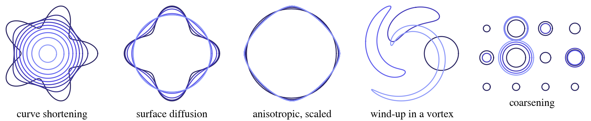
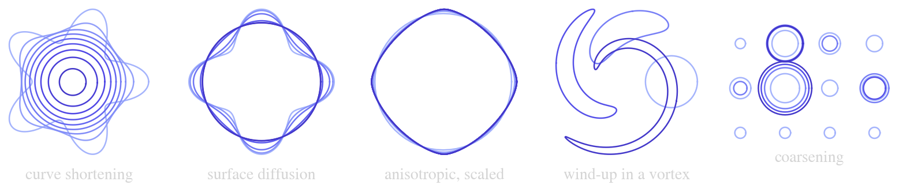

# ThetaL.jl




ThetaL evolves closed plane curves. Each curve moves with an outward normal velocity that you compute, and the
velocity of each curve may depend on all the curves:

```math
(U_1, \dots, U_N) = F(X_1, \dots, X_N; t).
```

ThetaL holds each curve in the θ–L variables of Hou, Lowengrub & Shelley (1994): its tangent angle ``\theta(\alpha)``
and length ``L``, sampled at ``N`` points equally spaced in arclength. It does three things for you:

- **Keeps the points at equal arclength**, through the tangential velocity, so the grid never tangles or bunches.
- **Treats the stiff small scales exactly.** You give the growth rate ``\sigma(q)`` of a small-scale mode of
  wavenumber ``q`` along the curve (the symbol, ``\sigma < 0`` damping: `q -> -q^2` for ``U = -\kappa``); the step
  integrates that part exactly with an exponential integrator, so the time step is not tied to the grid spacing.
- **Integrates rigid motion exactly.** The rigid part of each curve's velocity (translation and rotation) is taken
  out and integrated exactly: a curve that turns or drifts without deforming does so to roundoff at any time step.

It knows nothing of the physics behind ``F``. In the [Examples](@ref) it is curve shortening, surface diffusion,
anisotropic surface energy, a flow field, or a mean field coupling a dozen particles.

## In one call

```julia
using ThetaL, DotPlots

X = ξ -> (1 + 0.3cos(5ξ)) .* (cos(ξ), sin(ξ))
U = (X, t) -> -curvature(X)
tspan = (0, 0.1)
sol = evolve(X, U, tspan; dt = 1e-3, symbol = q -> -q^2, saveat = 0.02)
area(sol(0.1))     # ≈ A₀ − 2π·0.1: curve shortening removes area at the rate 2π
dotplot(sol)       # the curves in the terminal, colored by time
```

## What it offers

| | |
|:--|:--|
| Problems | any number of curves, a velocity that couples them, a stiff symbol, a function of the wavenumber that may also depend on the curve |
| Schemes | exponential Runge–Kutta, `ETDRK2` (order 2, with an error estimate) and `ExpEuler` (order 1); others are a type and a weights function |
| Integrator | exact landing on a time, transactional steps (a rejected step changes nothing), warm-start contexts for expensive velocities |
| Curves | added, removed, replaced or refined between steps; ids stay stable; checkpoints restart a run identically |
| Utilities | distances (close approach), integrals along a curve, the parallel curve, area-preserving projections, the velocity of the tracked points |

## Where to go next

- [Getting started](@ref): installation, one call, a problem and its integrator, the velocity protocol.
- [Method](@ref "Method overview"): the kinematics, the rigid split, the schemes, the symbols, and the limits.
- [Examples](@ref): seven scripts, drawn in the terminal.
- [API reference](@ref) and the [Code map](@ref): every function, and which feature runs it.
