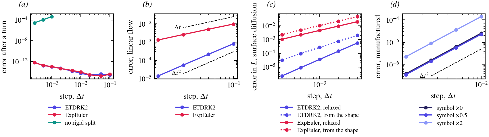
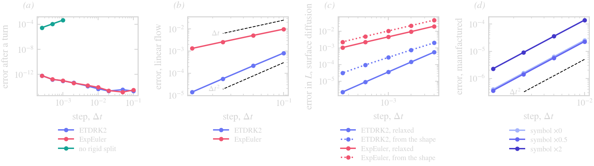

# Method overview

A step of ThetaL has three parts, each on its own page:

1. [Kinematics and the rigid split](@ref): how a normal velocity moves a curve held at equal arclength, and how its
   rigid part is taken out and integrated exactly.
2. [Schemes](@ref): the one-step exponential Runge–Kutta methods that advance all curves together, with the stiff
   part exactly and the rest explicitly.
3. [Symbols, filter and resolution](@ref): the stiff rate per mode that the caller gives, the spectral filter, and
   when N changes.

[Limits](@ref) lists where the method needs care: close approach, rough velocities, the explicit tangential
transport, and the initial layer of a stiff problem.

## Validation

*(a)* A smooth curve turning once about a point outside it: with the rigid split the shape after a turn is exact to
roundoff at any step, for both schemes; without it (`rigid = :none`) the rotation is an explicit transport, stable
only below Δt ≈ 10⁻³ and second order there. *(b)* A linear flow ``u = Ax``, against the exact image of the curve:
ETDRK2 is second order, ExpEuler first. *(c)* Surface diffusion (``U = \kappa_{ss}``, symbol ``\sigma = -q^4``),
the error in the length at ``t = 0.05``: from a relaxed state both schemes keep their orders; from the shape itself
the first steps carry an initial layer ([Limits](@ref)). *(d)* A manufactured deforming ellipse (axes and
orientation changing in time; ``U = -F_t/|\nabla F|`` of its level set): second order whatever symbol is given,
including deliberately wrong ones. The data come from `docs/figures/make_data.jl`; the tests
(`test/test_stepping.jl`, `test/test_integrator.jl`) check the same orders.
