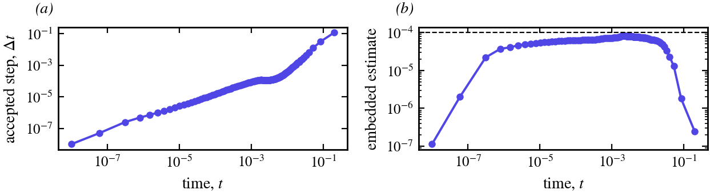
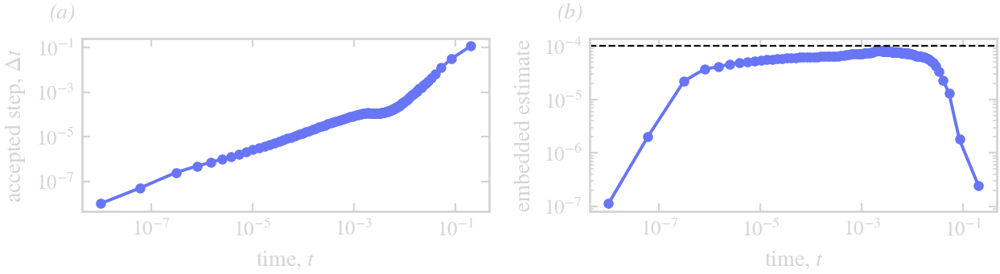

# Limits

## Close approach

The small-scale decomposition assumes that the stiff part of the velocity is local to each curve and diagonal in
``k``, and that the coupling between curves is smooth. Where two curves, or two parts of one curve, come within a
gap ``d``, the facing segments are stiff in the coupling at ``k \sim L/d``, in a way that is local along the curve
and that no symbol in ``k`` expresses. The step then needs ``\Delta t \lesssim d \cdot (\text{a time scale})``,
and the equal-arclength grid needs ``N \sim L/d`` on the whole curve. ThetaL does not cure this; `min_distance`
monitors it (between curves, and between parts of a curve more than a quarter of its length apart along it).

## The smoothness of the velocity

``\theta_t`` contains ``U_\alpha``, computed spectrally, so the normal velocity must be smooth to the tolerance at the
grid points. A velocity interpolated from a finite element trace, or a flux jump read off a grid, has kinks between
elements; they excite high modes and N keeps doubling. Fit such a velocity to the curve's grid first.

## The tangential transport

After the rigid part is taken out, the tangential velocity of the deformation still moves the points along the
curve, and that transport is explicit: modes of wavenumber ``k`` oscillate at about ``k|T|/s_\alpha``, which the
explicit stages follow only for ``\Delta t \lesssim s_\alpha/(k_{\max}|T|)``. A symbol of first order or more damps
it; beyond it the step is unstable. In the manufactured test of the [Method overview](@ref) the runs without a
damping symbol are unstable at Δt = 0.02 and stable at 0.01.

## The initial layer

From a shape far from equilibrium under a stiff symbol (surface diffusion, ``\sigma = -q^4``), the first steps are
first order in Δt: modes with ``|\sigma| h \gg 1`` decay within a step and drive ``L_t``, which the explicit update
of ``L`` follows only for ``\Delta t \ll 1/|\sigma|``. Once they have relaxed the schemes keep their orders ([Method
overview](@ref), panel (c)). Small first steps remove the layer; the embedded estimate picks them by itself:

*(a)* The accepted steps of the control in `examples/step_control.jl`, run to ``t = 0.2`` (surface diffusion of a
four-lobed flower, ETDRK2, estimate held below 10⁻⁴): from 10⁻⁸ through the layer to 0.1. *(b)* The embedded estimate of each accepted step, against the tolerance (dashed).

## Frozen symbols

The rates are held for a step at the start-of-step length. A symbol that varies along the curve (anisotropy) is
frozen at a bound; stiffness that is not diagonal in ``k`` (variable coefficients, coupling between curves) cannot
be expressed.
